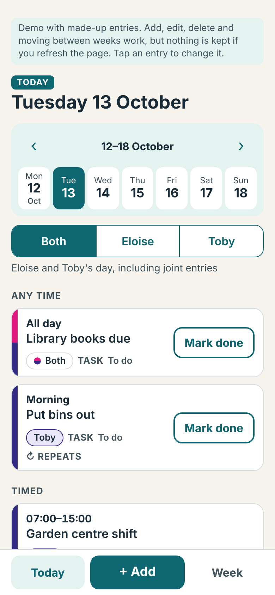
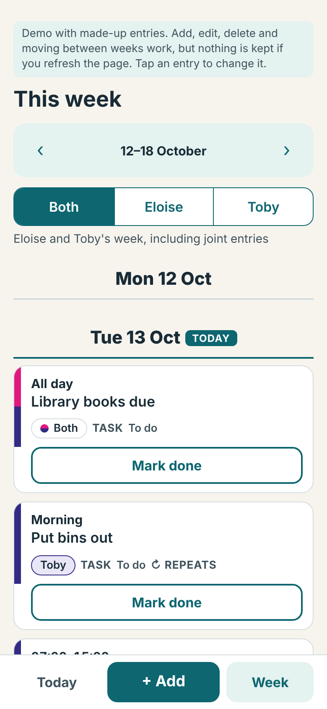
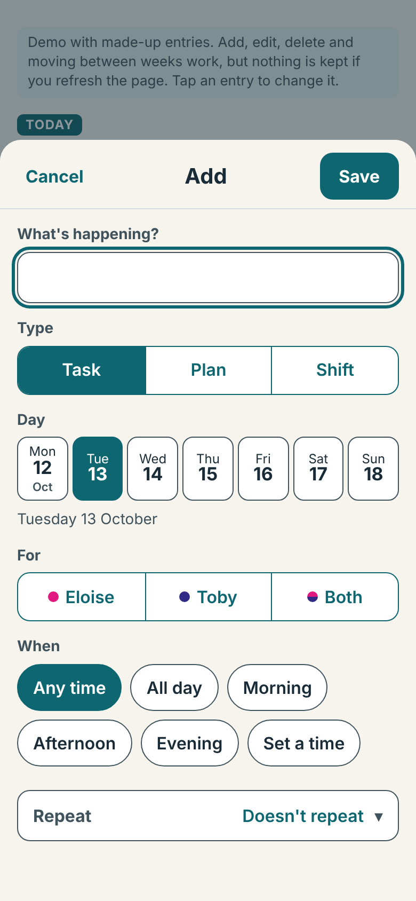
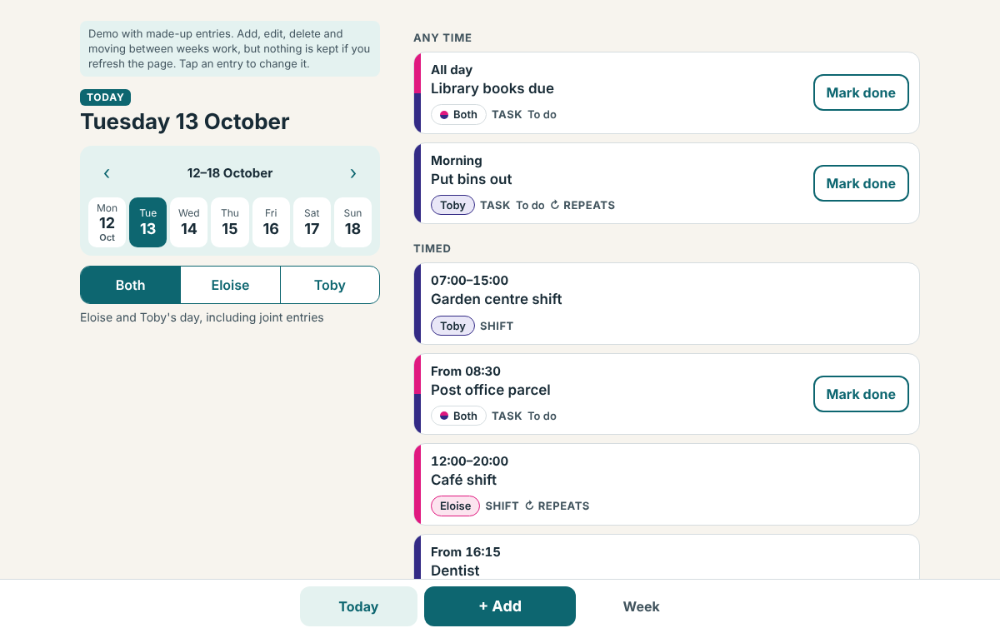

# Our Week

A private weekly planner for two people, built to be used on two iPhones and on a desktop.
Both people edit one shared plan, and a change made on one phone appears on the other almost
straight away.

**Live demo:** [open it with made-up entries](https://chasemystatus.github.io/our-week/?demo=1). Nothing you add is saved.

## Why I made it

Eloise, my eldest daughter, had just started a new job and was overwhelmed one Sunday night trying to reconcile her schedule with Toby's. I helped her put together a simple weekly planner, and Our Week grew from that idea so the two of them can keep using it from here on.

The entries in the screenshots and in demo mode are made up.

<p>
  
  
  
</p>



## What it does

- **Tasks, plans and shifts**, each for Eloise, for Toby, or for both. Timed or untimed.
- **Joint entries are stored once.** If either person ticks off a joint task, it's done for both.
- **Repeating entries** (weekly, every few weeks, or monthly). Only entries marked as repeating carry into new weeks; everything else stays in the week it was made. Changing or skipping one week of a repeating entry leaves the rest alone.
- **Previous weeks stay available**, with a week view and a day view.
- **Saves to a shared database** and updates the other person's screen live. If a save fails, the page says so and keeps the change until it can save.
- **Private**: only the two people on an allow-list can read or write anything. Public sign-up is off.
- **Back up and restore** to a file. Restore checks the file carefully before it replaces anything.
- Changes are confirmed before anything is deleted or signed out.

## How it's built

- **Front end:** one HTML file (`app/index.html`) with plain JavaScript and CSS. No framework, no build step.
- **Back end:** [Supabase](https://supabase.com) (Auth, Postgres with row-level security, Realtime). The Supabase JavaScript library is included in `app/vendor/` rather than loaded from a CDN.
- **Hosting:** any static host. I used Netlify; `app/_headers` carries the security headers.

### Where the privacy is enforced

Hiding a login page isn't privacy. Access is enforced on the stored data itself:

- Row-level security is on for every table.
- A function, `is_member()`, checks that the signed-in person's email is on the `members` list. Every planner table has a policy that requires it.
- Signed-out visitors have no access to any table. Signed-in people who aren't on the list can't read or write anything either.
- The page contains only Supabase's *publishable* key, which is designed to be public. The secret key is never used.

`supabase/rls_check.sql` tests these rules and then undoes everything it did, so it changes nothing. This is a check I wrote for my own project, not an independent security audit.

### Design decisions worth knowing about

- **Dates are plain `YYYY-MM-DD` text**, with "today" worked out in Europe/London, so daylight-saving changes can't move an entry to the wrong day.
- **Saving only sends what changed.** The app remembers what the database last held and sends just the differences, so two phones editing different entries don't overwrite each other.
- **Repeating entries are a rule plus exceptions**, not a copy for every week, so changing "this week only" is a small exception and not an edit to every copy.
- **Last write wins** if two people change the same entry at the same moment.
- Only the latest delete can be undone, and only for a few seconds.

## What's in this repo

- `app/` is the planner itself. `index.html` holds all of the app's code, `vendor/` holds the Supabase JavaScript library, `_headers` holds the security headers for Netlify, and the icon files and `manifest.webmanifest` give it a home-screen icon.
- `supabase/` holds `schema.sql`, which sets up the database and its privacy rules, and `rls_check.sql`, which tests those rules.
- `tests/` holds the automated tests, the pretend Supabase they run against (`mock.py`), and `run_tests.sh` to run them all.
- `docs/screenshots/` holds the pictures used in this README.
- `LICENSE` is the MIT licence.

## Try it without any setup

Open `app/index.html?demo=1` in a browser, or serve the folder:

```bash
cd app
python3 -m http.server 8000
# then visit http://localhost:8000/index.html?demo=1
```

Demo mode shows made-up entries. Adding, editing and deleting work, but nothing is kept when you refresh.

## Set up your own copy

You need a free Supabase project and somewhere to host a static site.

1. **Create a Supabase project.**
2. **Set up the database.** Open `supabase/schema.sql`, change the two example emails at the bottom to the two people who should be allowed in, and run the whole file in the Supabase SQL Editor. It's safe to run again.
3. **Set up sign-in.** In Authentication, keep the Email provider on and turn **public sign-up off**. Set a minimum password length. Create the two users by hand (Authentication > Users > Add user) with *Auto Confirm User* ticked. Supabase's built-in email sender only delivers to your own team address and is not meant for production, so invite and reset emails won't reach other people unless you add your own email service. Menu names change over time, so look for the nearest match.
4. **Check the rules.** Run `supabase/rls_check.sql` (with your two emails filled in). You should see ✅ on every line.
5. **Point the app at your project.** In `app/index.html`, replace `YOUR-PROJECT-REF` and `YOUR-PUBLISHABLE-KEY` in `CONFIG` with your project address and **publishable** key. Never use a secret or `service_role` key here. Replace `YOUR-PROJECT-REF` in `app/_headers` as well, because the security policy only allows connections to your project.
6. **Host the `app` folder.** On Netlify you can drag the folder onto a new project. Sign in, add something, and check it appears on a second device.

## Tests

The tests drive the real page in Chromium with Playwright. A pretend Supabase (`tests/mock.py`) stands in for the back end, so they run offline and need no project.

```bash
pip install playwright
playwright install chromium
./tests/run_tests.sh
```

They cover adding, editing and deleting; repeating entries across weeks; joint tasks; sign-in and sign-out; failed and recovered saves; two devices staying in step; and backup and restore. They can't test the real database rules, which is what `supabase/rls_check.sql` is for, or how an iPhone behaves, which I checked by hand.

## Known limits

- Two people only. Adding a third means a new user and a new row in `members`.
- The app loads every entry rather than one month at a time, which is fine for two people's plans.
- On the free Supabase plan, a project that nobody uses for about a week is paused until you resume it.

## Built with

Written with Claude (Anthropic) as a coding assistant.

## Licence

MIT. See [LICENSE](LICENSE).
